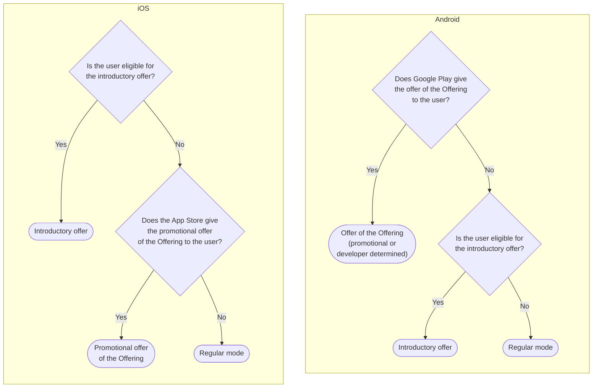

**Offer mode** in Purchasely screen composer allows you to display an alternative copy or price for your offers. This feature is perfect for new user acquisition, retention and winback an expired user and lets you leverage the same Screen / Paywall both for end-users who are eligible to an Offer and those who are not.

## When is Offer Mode displayed?

**Offer Mode** is displayed only when the end-user is eligible for the Offer associated with the plan—either an Introductory Offer or a Promotional Offer configured in the Offering. If no specific text has been defined for Offer Mode, the SDK automatically falls back to the Regular Mode text. 

If the user is eligible for the two offers, iOS and Android do not use the same offer. See [Which offer the SDK uses](#which-offer-the-sdk-uses).

 

## Which offer the SDK uses

A plan can have an introductory offer (for example a free trial) and a promotional offer in its Offering. The SDK selects one offer. It uses this offer for the Offer mode texts, the offer price tags and the purchase. iOS and Android select the offer in a different order, because the App Store and Google Play give offers to users in different ways.

| Platform | Order | Why |
| :-- | :-- | :-- |
| iOS | 1. The introductory offer, if the user is eligible for it. 2. If not, the promotional offer of the Offering, if the App Store gives it to the user. 3. If not, the Regular mode. | The App Store gives promotional offers only to current and past subscribers. |
| Android | 1. The offer of the Offering (promotional or developer determined offer), if Google Play gives it to the user. 2. If not, the introductory offer (the default offer of the base plan), if the user is eligible for it. 3. If not, the Regular mode. | Google Play gives a "New customer acquisition" offer only to an eligible user. Thus the offer of the Offering already follows the eligibility rules of Google Play. |

The default offer of an Android base plan is its first offer without the `ignore-offer` tag.

**Example:** a plan has a 7-day free trial, and its Offering contains a 40% discount offer.

* On Android, a new user sees and buys the 40% discount, not the free trial.
* On iOS, the same user sees and buys the free trial.

In Observer mode, the SDK sends the selected offer to your purchase interceptor. On Android, the `Purchase` action contains this offer in `offer` and `subscriptionOffer`.

### Developer determined offers (Google Play)

Google Play gives a "Developer determined" offer to all users. Your app decides which users are eligible. Thus, on Android, if the Offering contains a developer determined offer, the SDK shows the Offer mode and buys this offer for all users. `isEligibleToOffer(storeOfferId)` also returns `true` for all users.

To give this offer only to the users that you select, use one of these solutions:

* **A user attribute.** Set a custom [user attribute](conditional-visibility#user-attribute-value) from your app (for example `eligible_promo_offer`). Use it in a conditional visibility rule or in an [Audience](conditional-visibility#audience). Show the purchase button with the Offering only to these users.
* **The eligibility to the introductory offer.** Use the [Eligibility for an Offer](conditional-visibility#eligibility-for-an-offer) condition. Show a purchase button without Offering to the users who are eligible for the introductory offer. Show the purchase button with the developer determined offer to the users who are not eligible.

> 📘 The "Eligibility for an Offer" condition
>
> The [Eligibility for an Offer](conditional-visibility#eligibility-for-an-offer) condition checks only the introductory offer, on iOS and on Android. It does not check the promotional offer of the Offering. Thus, on Android, a component with this condition can stay hidden while the purchase button buys the promotional offer.

 

## How to customize a paywall for offer mode:

Once you have prepared a paywall for Regular Mode, you turn on the offer mode radio button on the top of the screen and customize each and every text element you have filled for the regular mode you can customize it for offer mode. 

<Image align="center" src="https://files.readme.io/f6fb5b7e2d3812d0e7e282c89635cf14bab293bb44bf898e5cd4fea955d2c5e6-Screen_Recording_2025-03-17_at_11.19.04.gif" />

## How to display the offer price for different regions ?

Purchasely provides you with tags to automatically to fetch the offer price and offer duration. 

Use the following tag to show the the[ introductory offer](https://docs.purchasely.com/docs/app-store-configuring-in-app-subscriptions#adding-introductory-offers-and-free-trials) or [new user acquisition offer](https://docs.purchasely.com/docs/play-store-configuring-in-app-subscriptions#creating-offer-plans) & [promotional offer](https://docs.purchasely.com/docs/promotional-offers-configuration) or [developer determined offer](https://docs.purchasely.com/docs/developer-determined-offers-configuration) price. 

<Table align={["left","left","left"]}>
  <thead>
    <tr>
      <th>
        Tag
      </th>

      <th>
        Usage
      </th>

      <th>
        Example
      </th>
    </tr>
  </thead>

  <tbody>
    <tr>
      <td>
        `OFFER_PRICE`
      </td>

      <td>
        Displays the winback offer price.
      </td>

      <td>
        For a winback offer :  

        * Don't miss the intro offer of **\{\{OFFER\_PRICE}}** for the first week.  
        * The output will be:\
          *Don't miss the intro offer of $0.99/week for the first week.*
      </td>
    </tr>

    <tr>
      <td>
        `OFFER_AMOUNT`
      </td>

      <td>
        Displays the winback offer amount.
      </td>

      <td>
        For a winback offer :  

        * Don't miss the intro offer of **\{\{OFFER\_AMOUNT}}** for the first month.  
        * The output will be:\
          *Don't miss the intro offer of $5.99 for the first month.*
      </td>
    </tr>

    <tr>
      <td>
        `OFFER_PERIOD`
      </td>

      <td>
        Displays the winback offer period.
      </td>

      <td>
        For an extension of a free trial:  

        * Don't miss the free trial for a **\{\{OFFER\_PERIOD}}**.  
        * The output will be:\
          *Don't miss the free trial for a week.*
      </td>
    </tr>

    <tr>
      <td>
        `OFFER_DURATION`
      </td>

      <td>
        Displays the winback offer duration.
      </td>

      <td>
        For a winback:  

        * Hurry up intro offer for **\{\{OFFER\_AMOUNT}}**/ **\{\{OFFER\_DURATION}}**.  
        * The output will be:\
          *Hurry up intro offer for $0.99 / 1week.*
      </td>
    </tr>

    <tr>
      <td>
        `OFFER_PRICE_COMPARISON`
      </td>

      <td>
        Displays the price difference between the discounted offer and the regular price of the plan for the higher duration.
      </td>

      <td>
        With:  

        * offer price: $99.99/year
        * monthly: $9.99/month  
          * \*\{\{OFFER\_PRICE\_COMPARISON}}\*\* will display $19.89
      </td>
    </tr>

    <tr>
      <td>
        `OFFER_DISCOUNT_PERCENTAGE`
      </td>

      <td>
        Displays the discount percentage between the discounted offer and the regular price of the plan.
      </td>

      <td>
        With:  

        * offer price: $99.99/year
        * monthly: $9.99/month  
          * \*\{\{OFFER\_DISCOUNT\_PERCENTAGE(plan1,plan2)}}\*\* will display 17%
      </td>
    </tr>
  </tbody>
</Table>

 

## Get user eligibility to introductory offer

Purchasely SDK provides a method to retrieve easily from your application if a user is eligible to a introductory offer (or free trial)\
More information in the [dedicated article](eligibility-intro-offer)
