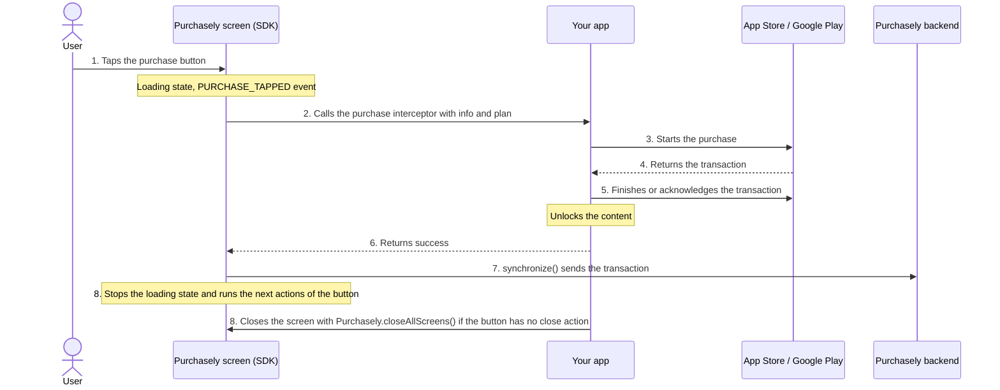
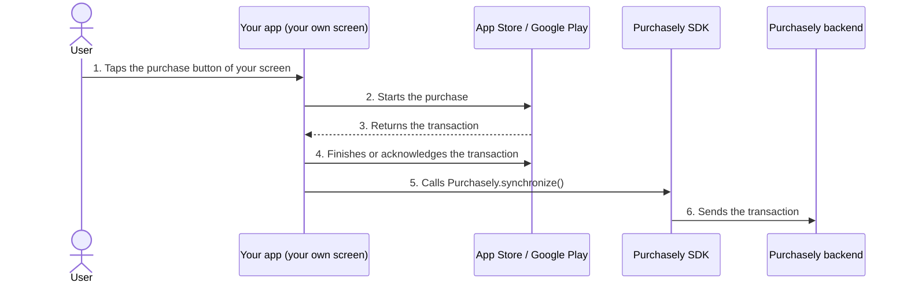

In `observer` mode, your app processes the transactions and Purchasely observes them. The Purchasely SDK displays the screens. When the user taps a purchase or restore button, the SDK gives the action to your app with the <Glossary>Action Interceptor</Glossary>. Your app does the purchase, then tells the SDK the result.

This page shows the full flow, what the SDK does after each result, and the code for each platform.

# How a purchase works in observer mode

## Who does what

| Step | Purchasely SDK | Your app |
| :-- | :-- | :-- |
| Display the screen | ✅ | |
| Show the loading state on the button and call your interceptor | ✅ | |
| Start the purchase or the restore (StoreKit, Google Play Billing, RevenueCat, your own system) | | ✅ |
| Finish the transaction (StoreKit) or acknowledge it (Google Play) | | ✅ |
| Unlock the content | | ✅ |
| Return the result to the interceptor (`success`, `failed` or `notHandled`) | | ✅ |
| Send the transaction to Purchasely (`synchronize()`) | ✅ after `success` on a purchase | ✅ after a purchase on a screen of your app, and after a restore on iOS |
| Close the screen | ✅ only when the button has a close action after the purchase | ✅ in all other cases, with `Purchasely.closeAllScreens()` |

In observer mode, the SDK never starts a purchase with the store. It also does not finish (StoreKit) or acknowledge (Google Play) a transaction. Your app must do these steps.

The interceptor receives:

* `info` (`PLYInterceptorInfo`): the `contentId` and the `presentation` object of the screen. It also gives the view that displays the screen: `info.controller` on iOS, `info.activity` on Android. Use it to show your own views or error messages above the screen.
* the parameters of the action: for a purchase, the `plan` that the user selected (and, on Android, the `subscriptionOffer`). A restore has no parameters.

## Flow 1: purchase on a Purchasely screen

<!-- TODO(screenshot): upload tmp/observer-interceptor/1-storyboard.png to ReadMe, then replace this comment with:
<Image align="center" className="border" border={true} src="REPLACE_WITH_FILES_README_IO_URL" alt="A purchase in observer mode: the Purchasely screen, the loading state, the App Store sheet, the confirmation, the unlocked content" />
-->



1. The user taps the purchase button. The SDK shows the loading state on the button and sends the `PURCHASE_TAPPED` event.
2. The SDK calls your purchase interceptor with `info` and the `plan` (and the `subscriptionOffer` on Android).
3. Your app starts the purchase with its system: StoreKit, Google Play Billing, RevenueCat or your own system.
4. The store returns the transaction to your app.
5. Your app finishes (StoreKit) or acknowledges (Google Play) the transaction, and unlocks the content.
6. Your app returns `success` to the interceptor.
7. The SDK calls `synchronize()`. It sends the transaction to the Purchasely backend, which updates the subscription, the events and the dashboards.
8. The SDK stops the loading state and runs the next actions of the button. If the button has no close action after the purchase, your app closes the screen with `Purchasely.closeAllScreens()`.

> 🚧 Return the result only when the purchase is complete
>
> The SDK calls `synchronize()` as soon as you return `success`. If you return `success` before the store confirms the purchase, Purchasely receives no new transaction.

## Flow 2: purchase on a screen of your app

When the user buys from a screen of your app (not a Purchasely screen), no interceptor runs. The SDK does not know about the purchase. Your app must call `Purchasely.synchronize()` after the transaction.



Call `Purchasely.synchronize()` after each transaction that your app completes outside of a Purchasely screen:

```swift
// After the transaction is complete (and finished) in your app
Purchasely.synchronize(success: {
    // Purchasely received the transaction
}, failure: { error in
    // Log the error: the purchase itself is not affected
})
```
```kotlin
// After the purchase is complete (and acknowledged) in your app
Purchasely.synchronize(
    onSuccess = { /* Purchasely received the purchase */ },
    onError = { error -> /* Log the error: the purchase itself is not affected */ }
)
```
```javascript React Native
// After the purchase is complete in your app
try {
  await Purchasely.synchronize();
} catch (e) {
  // Log the error: the purchase itself is not affected
}
```
```javascript Flutter
// After the purchase is complete in your app
try {
  await Purchasely.synchronize();
} on PlatformException catch (e) {
  // Log the error: the purchase itself is not affected
}
```
```javascript Cordova
// After the purchase is complete in your app
Purchasely.synchronize(
  () => { /* Purchasely received the purchase */ },
  (error) => { /* Log the error: the purchase itself is not affected */ }
);
```

## Restore

The restore flow is the same as Flow 1, with these differences:

* The SDK sends the `RESTORE_TAPPED` event and calls your restore interceptor. A restore has no parameters.
* Your app restores the purchases with its system, then returns `success` or `failed`.

> 🚧 On iOS, call `Purchasely.synchronize()` in your restore interceptor
>
> On iOS (SDK 6.2), the SDK does not call `synchronize()` after a restore that returns `success`. Call `Purchasely.synchronize()` in your restore interceptor, before you return `success`. On Android, the SDK calls it for you.
>
> This also applies to React Native, Flutter and Cordova apps on iOS.

## What the SDK does after each result

| Result | Purchase | Restore | Loading state | Next actions of the button |
| :-- | :-- | :-- | :-- | :-- |
| `success` | The SDK calls `synchronize()` | Android: the SDK calls `synchronize()`. iOS: no call, call it yourself | Stops | The SDK runs them (for example a close) |
| `failed` | No synchronization | No synchronization | Stops | Cancelled: the screen stays open. The SDK shows no error message: show your own if necessary |
| `notHandled` | Nothing: in observer mode, the SDK does not start a store purchase | Nothing | Stops | The SDK runs them |

> 📘 The user cancels the purchase
>
> No `cancelled` result exists. Return `failed` when the user cancels in the store sheet: the screen stays open and no synchronization occurs. With `success` or `notHandled`, the SDK runs the next actions of the button, for example a close.

In observer mode, a purchase or restore button with no registered interceptor does nothing: the SDK stops the loading state and does not start a store purchase.

# Implementing the Action Interceptor

You register one interceptor per action with `Purchasely.interceptAction`. The samples below show the `purchase` and `restore` interceptors.

## Processing transactions with your in-house system

Here is a code sample using the Action Interceptor to process transactions **with your own in-house purchase system** , for the actions `purchase` and `restore`:

```swift
Purchasely.interceptAction(.purchase) { info, params, completion in
    // Grab the plan to purchase
    guard let plan = params?.plan, let appleProductId = plan.appleProductId else {
        completion(.notHandled)
        return
    }

    let success = MyPurchaseSystem.purchase(appleProductId)
    if success {
        // SDK auto-synchronizes on success in observer mode
        completion(.success) // notify Purchasely paywall to stop processing action
    } else {
        completion(.failed)
    }
}

Purchasely.interceptAction(.restore) { info, params, completion in
    MyPurchaseSystem.restorePurchases()
    // SDK auto-synchronizes on success in observer mode
    completion(.success) // notify Purchasely paywall to stop processing action
}
```
```kotlin
Purchasely.interceptAction<PLYPresentationAction.Purchase> { info, purchase ->
    val subscriptionId = purchase.subscriptionOffer?.subscriptionId
    val basePlanId = purchase.subscriptionOffer?.basePlanId
    val offerId = purchase.subscriptionOffer?.offerId
    val offerToken = purchase.subscriptionOffer?.offerToken

    // you just need to pass the offerToken to BillingClient
    val success = MyPurchaseSystem.purchase(offerToken)

    if (success) {
        // SDK auto-synchronizes on success in observer mode
        PLYInterceptResult.SUCCESS // notify Purchasely paywall to stop processing action
    } else {
        PLYInterceptResult.FAILED
    }
}

Purchasely.interceptAction<PLYPresentationAction.Restore> { info, _ ->
    MyPurchaseSystem.restoreAllPurchases()
    // SDK auto-synchronizes on success in observer mode
    PLYInterceptResult.SUCCESS // notify Purchasely paywall to stop processing action
}

// The interceptAction<T> { … } lambda above is a suspend lambda: you RETURN the result.
// If your call site is not a coroutine (e.g. your billing system reports through a callback),
// use the Class-based overload (::class.java) and return the result via the `result` lambda:
Purchasely.interceptAction(PLYPresentationAction.Purchase::class.java) { info, action, result ->
    val purchase = action as PLYPresentationAction.Purchase   // not cast for you here
    val offerToken = purchase.subscriptionOffer?.offerToken

    MyPurchaseSystem.purchase(offerToken) { success ->
        // called later from your billing callback — call result exactly once
        result(if (success) PLYInterceptResult.SUCCESS else PLYInterceptResult.FAILED)
    }
}
```
```javascript React Native
// Register one interceptor per action kind; each returns 'success' | 'failed' | 'notHandled'.
Purchasely.interceptAction('purchase', async (info, payload) => {
  if (payload?.kind !== 'purchase') {
    return 'notHandled';
  }
  try {
    // the store product id (sku) the user clicked on in the paywall
    const storeProductId = payload.plan.productId;

    if (Platform.OS === 'android') {
      // Only for Android you can retrieve other information about the purchase
      const basePlanId = payload.subscriptionOffer?.basePlanId;
      const offerId = payload.subscriptionOffer?.offerId;
      const offerToken = payload.subscriptionOffer?.offerToken;
    }

    const success = await MyPurchaseSystem.purchase(storeProductId);
    if (success) {
      // SDK auto-synchronizes on success in observer mode
      return 'success'; // notify Purchasely paywall to stop processing action
    }
    return 'failed';
  } catch (e) {
    console.log(e);
    return 'failed';
  }
});

Purchasely.interceptAction('restore', async (info, payload) => {
  try {
    await MyPurchaseSystem.restorePurchases();
    // SDK auto-synchronizes on success in observer mode
    return 'success'; // notify Purchasely paywall to stop processing action
  } catch (e) {
    return 'failed';
  }
});
```
```javascript Flutter
// Register one handler per action kind; each returns a PLYInterceptResult.
await Purchasely.interceptAction(
  PLYPresentationActionKind.purchase,
  (info, payload) async {
    if (payload is! PLYPurchasePayload) {
      return PLYInterceptResult.notHandled;
    }
    try {
      //the store product id (sku) the user clicked on in the paywall
      final productId = payload.plan.productId;

      if (Platform.isAndroid) {
        // Only for Android you can get other interesting parameters
        final basePlanId = payload.subscriptionOffer?.basePlanId;
        final offerId = payload.subscriptionOffer?.offerId;
        final offerToken = payload.subscriptionOffer?.offerToken;
      }

      final success = await MyPurchaseSystem.purchase(productId);
      if (success) {
        // SDK auto-synchronizes on success in observer mode
        return PLYInterceptResult.success;
      }
      return PLYInterceptResult.failed;
    } catch (e) {
      print(e);
      return PLYInterceptResult.failed;
    }
  },
);

await Purchasely.interceptAction(
  PLYPresentationActionKind.restore,
  (info, payload) async {
    try {
      await MyPurchaseSystem.restoreAllPurchases();
      // SDK auto-synchronizes on success in observer mode
      return PLYInterceptResult.success;
    } on PlatformException {
      // Error restoring purchases
      return PLYInterceptResult.failed;
    }
  },
);
```
```javascript Cordova
// Register one handler per action; each returns (or resolves to) a Purchasely.InterceptResult.
Purchasely.interceptAction(Purchasely.PresentationAction.purchase, async (info, parameters) => {
  // the store product id (sku) the user clicked on in the paywall
  const storeProductId = parameters.plan.productId;
  try {
    await MyPurchaseSystem.purchase(storeProductId);
    // SDK auto-synchronizes on success in observer mode
    return Purchasely.InterceptResult.success;
  } catch (e) {
    // Error making purchase
    return Purchasely.InterceptResult.failed;
  }
});

Purchasely.interceptAction(Purchasely.PresentationAction.restore, async (info, parameters) => {
  try {
    await MyPurchaseSystem.restoreTransactions();
    // SDK auto-synchronizes on success in observer mode
    return Purchasely.InterceptResult.success;
  } catch (e) {
    // Error restoring purchases
    return Purchasely.InterceptResult.failed;
  }
});
```

> 📘 You don't need to call `synchronize()` yourself here
>
> When your interceptor returns the success result for a purchase or restore in observer mode, the Purchasely SDK calls `synchronize()` automatically to observe the transaction (fetch the receipt and pass it to the Purchasely Platform without interfering with it). Call `synchronize()` manually only for transactions completed outside the interceptor — see your platform page's "synchronize() with callbacks" section.

## Processing transaction with RevenueCat

Here is a code sample using the Action Interceptor to process transactions **with RevenueCat** , for the actions `purchase` and `restore`:

```swift
Purchasely.interceptAction(.purchase) { info, params, completion in
    // Grab the plan to purchase
    guard let plan = params?.plan, let appleProductId = plan.appleProductId else {
        completion(.notHandled)
        return
    }

    Purchases.shared.getOfferings { (offerings, error) in
        if let packages = offerings?.current?.availablePackages {
            if let package = packages.first(where: { $0.storeProduct.productIdentifier == appleProductId }) {
                Purchases.shared.purchase(package: package) { (transaction, customerInfo, error, userCancelled) in
                    /** IMPORTANT for Purchasely **/
                    // SDK auto-synchronizes on success in observer mode
                    // notify Purchasely paywall to stop processing action
                    completion(.success)

                    if customerInfo.entitlements["your_entitlement_id"]?.isActive == true {
                        // Unlock that great "pro" content              
                    }
                }
            }
        }
    }
}

Purchasely.interceptAction(.restore) { info, params, completion in
    Purchases.shared.restorePurchases { customerInfo, error in
        /** IMPORTANT for Purchasely **/
        // SDK auto-synchronizes on success in observer mode
        // notify Purchasely paywall to stop processing action
        completion(.success)
    }
}
```
```kotlin
Purchasely.interceptAction<PLYPresentationAction.Purchase> { info, purchase ->
    val subscriptionId = purchase.subscriptionOffer?.subscriptionId
    val basePlanId = purchase.subscriptionOffer?.basePlanId
    val offerId = purchase.subscriptionOffer?.offerId
    val offerToken = purchase.subscriptionOffer?.offerToken

    //get RevenueCat package
    Purchases.sharedInstance.getOfferingsWith({ error ->
    // An error occurred
    }) { offerings ->
        offerings.current
            ?.availablePackages
            ?.takeUnless { it.isNullOrEmpty() }
            ?.let { list ->
             val rcPackage = list.firstOrNull { it.product.sku == subscriptionId }

             Purchases.sharedInstance.purchasePackage(
                this,
                rcPackage,
                onError = { error, userCancelled -> 
                    /* No purchase */
                },
                onSuccess = { product, customerInfo ->
                    if (customerInfo.entitlements["my_entitlement_identifier"]?.isActive == true) {
                        // Unlock that content
                        // SDK auto-synchronizes on success in observer mode
                    }
            })
        }
    }

    PLYInterceptResult.SUCCESS // notify Purchasely paywall to stop processing action
}

Purchasely.interceptAction<PLYPresentationAction.Restore> { info, _ ->
   // restore purchases with RevenueCat
    Purchases.sharedInstance.restorePurchases(::showError) { customerInfo ->
        //... check customerInfo to see if entitlement is now active

        // SDK auto-synchronizes on success in observer mode
    }

    PLYInterceptResult.SUCCESS // notify Purchasely paywall to stop processing action
}
```
```javascript React Native
// Register one interceptor per action kind; each returns 'success' | 'failed' | 'notHandled'.
Purchasely.interceptAction('purchase', async (info, payload) => {
  if (payload?.kind !== 'purchase') {
    return 'notHandled';
  }
  try {
    // the store product id (sku) the user clicked on in the paywall
    const storeProductId = payload.plan.productId;

    if (Platform.OS === 'android') {
      // Only for Android you can retrieve other information about the purchase
      const basePlanId = payload.subscriptionOffer?.basePlanId;
      const offerId = payload.subscriptionOffer?.offerId;
      const offerToken = payload.subscriptionOffer?.offerToken;
    }

    const offerings = await Purchases.getOfferings();
    if (offerings.current !== null && offerings.current.availablePackages.length !== 0) {
      // get your package
      const package = offerings.current.monthly;

      // and purchase with RevenueCat
      const { customerInfo, productIdentifier } = await Purchases.purchasePackage(package);
      if (typeof customerInfo.entitlements.active.my_entitlement_identifier !== 'undefined') {
        // SDK auto-synchronizes on success in observer mode
      }
      return 'success'; // notify Purchasely paywall to stop processing action
    }
    return 'failed';
  } catch (e) {
    console.log(e);
    return 'failed';
  }
});

Purchasely.interceptAction('restore', async (info, payload) => {
  try {
    await Purchases.restorePurchases();
    // ... check restored purchaserInfo to see if entitlement is now active

    // SDK auto-synchronizes on success in observer mode
    return 'success'; // notify Purchasely paywall to stop processing action
  } catch (e) {
    return 'failed';
  }
});
```
```javascript Flutter
// Register one handler per action kind; each returns a PLYInterceptResult.
await Purchasely.interceptAction(
  PLYPresentationActionKind.purchase,
  (info, payload) async {
    if (payload is! PLYPurchasePayload) {
      return PLYInterceptResult.notHandled;
    }
    try {
      //the store product id (sku) the user clicked on in the paywall
      final productId = payload.plan.productId;

      if (Platform.isAndroid) {
        // Only for Android you can get other interesting parameters
        final basePlanId = payload.subscriptionOffer?.basePlanId;
        final offerId = payload.subscriptionOffer?.offerId;
        final offerToken = payload.subscriptionOffer?.offerToken;
      }

      Offerings offerings = await Purchases.getOfferings();
      if (offerings.current != null && offerings.current.monthly != null) {
        //get your product from revenuecat
        Product product = offerings.current.monthly.product;

        //start purchase
        PurchaserInfo purchaserInfo = await Purchases.purchasePackage(product);
        if (purchaserInfo.entitlements.all["my_entitlement_identifier"].isActive) {
          // SDK auto-synchronizes on success in observer mode
        }
        return PLYInterceptResult.success;
      }
      return PLYInterceptResult.failed;
    } catch (e) {
      print(e);
      return PLYInterceptResult.failed;
    }
  },
);

await Purchasely.interceptAction(
  PLYPresentationActionKind.restore,
  (info, payload) async {
    try {
      PurchaserInfo restoredInfo = await Purchases.restoreTransactions();
      // ... check restored purchaserInfo to see if entitlement is now active

      // SDK auto-synchronizes on success in observer mode
      return PLYInterceptResult.success;
    } on PlatformException {
      // Error restoring purchases
      return PLYInterceptResult.failed;
    }
  },
);
```
```javascript Cordova
Purchasely.interceptAction(Purchasely.PresentationAction.purchase, async (info, parameters) => {
  // the store product id (sku) the user clicked on in the paywall
  const storeProductId = parameters.plan.productId;
  try {
    const offerings = await Purchases.getOfferings();
    if (offerings.current && offerings.current.monthly) {
      // get your package from RevenueCat
      const packageToBuy = offerings.current.monthly;
      const { purchaserInfo } = await Purchases.purchasePackage(packageToBuy);
      if (typeof purchaserInfo.entitlements.active.my_entitlement_identifier !== 'undefined') {
        // SDK auto-synchronizes on success in observer mode
      }
    }
    return Purchasely.InterceptResult.success;
  } catch (e) {
    // Error making purchase
    return Purchasely.InterceptResult.failed;
  }
});

Purchasely.interceptAction(Purchasely.PresentationAction.restore, async (info, parameters) => {
  try {
    await Purchases.restoreTransactions();
    // SDK auto-synchronizes on success in observer mode
    return Purchasely.InterceptResult.success;
  } catch (e) {
    // Error restoring purchases
    return Purchasely.InterceptResult.failed;
  }
});
```

## Common errors

| Error | Result | Correction |
| :-- | :-- | :-- |
| The interceptor returns `success` before the store confirms the purchase | Purchasely receives no new transaction | Return the result only when the purchase is complete |
| The interceptor returns `success` when the user cancels | The SDK runs the next actions of the button (for example a close) | Return `failed` |
| The screen stays open after the purchase | The button has no close action, and the SDK does not close the screen in observer mode | Call `Purchasely.closeAllScreens()`, or add a close action after the purchase |
| No `Purchasely.synchronize()` after a purchase on a screen of your app | Purchasely does not see the transaction | Call `Purchasely.synchronize()` after each transaction outside of a Purchasely screen (Flow 2) |
| No `Purchasely.synchronize()` in the restore interceptor on iOS | Purchasely does not see the restored purchases | Call `Purchasely.synchronize()` before you return `success` |
| The app does not finish (StoreKit) or acknowledge (Google Play) the transaction | The SDK does not do it in observer mode | Finish or acknowledge each transaction in your app |
| The interceptor does not return a result in one of its code paths | The button keeps its loading state, and the SDK writes a warning after 10 seconds | Return exactly one result in each code path |

<br />

[More details on the Action Interceptor and how to intercept of types of actions](action-interceptor)
